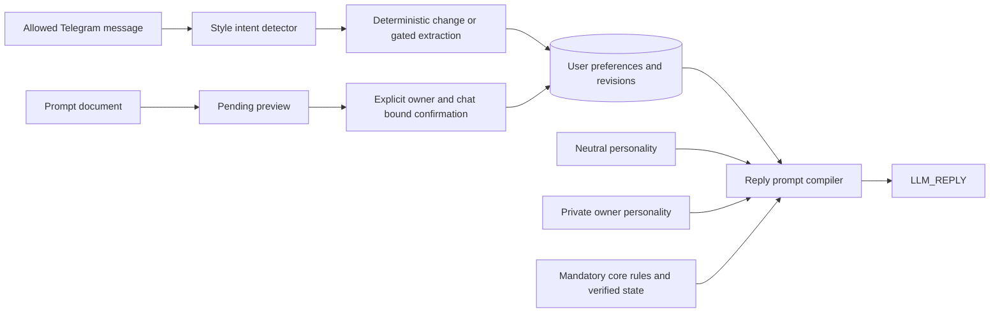

# Compiled reply personality

Jasmine starts with a neutral public voice. Each reply combines application-owned core rules, the neutral personality, an optional private owner personality, current user preferences, and the verified application report. Personalization affects only `LLM_REPLY`; it never enters the tool planner or executors.



## Communication changes

Explicit commands such as “обращайся ко мне на вы”, “давай лучше на ты”, “не используй эмодзи”, and “пиши теперь коротко” update structured settings without an extra model call. Ambiguous persistent style requests can use one additional `LLM_MAIN` extraction call. Values are restricted to known settings, backed by an exact input quote and sufficient confidence. Ordinary conversation, quoted examples, and detected requests for just one reply do not change persistent settings.

The detector is deliberately conservative; it does not understand every possible paraphrase. Unsupported requests produce a clarification. The model does not rewrite the system prompt or infer a new personality from ordinary jokes or slang.

| Setting | Values |
| --- | --- |
| `form_of_address` | `formal`, `informal` |
| `language` | `ru`, `en`, `auto` |
| `tone` | `neutral`, `friendly`, `playful`, `professional` |
| `verbosity` | `concise`, `balanced`, `detailed` |
| `humor` | `none`, `occasional`, `frequent` |
| `emoji` | `allowed`, `disabled` |
| `formatting` | `structured`, `conversational` |
| `grammatical_address` | `masculine`, `feminine`, `neutral` |
| `letter_case` | `standard`, `lowercase` |
| `final_sentence_period` | `allowed`, `disabled` |
| `long_dashes` | `allowed`, `disabled` |

Short custom writing rules support preferences outside these enums. Arbitrary imported custom instructions are stored separately and treated as lower-trust reply data, never executable code or authorization. Model-generated wording is still probabilistic: prompt-boundary tests do not prove perfect instruction following.

## Read, reset, and restore

- `/preferences` shows the current user's settings and custom instructions, without the operator personality or internal core prompt.
- `/forget_preference emoji` removes one saved enum setting, restoring its inherited/default behavior.
- `/reset_preferences` clears user settings, writing rules, and imported custom instructions. The private owner base personality remains.
- `/undo_preferences` restores the profile before the last change and records a new revision.

“покажи настройки общения”, “сбрось настройки общения”, and “верни прежний стиль” also work. Active preferences are loaded on every reply, including the reply to a change itself and unrelated topics. They are independent of relevance-filtered personal facts and conversation-history selection.

## Import a prompt document

Send `prompt.txt`, `prompt.md`, `prompt.markdown`, or `prompt.json`, or use another supported filename with the caption “настройки общения”. A filename triggers a preview only. Text files retain the full text as custom instructions and may extract supported style settings. JSON accepts only the following fields:

```json
{
  "preferences": {"form_of_address": "informal", "verbosity": "concise"},
  "custom_rules": ["Use short paragraphs."],
  "custom_instructions": "Keep explanations practical and concrete."
}
```

The preview includes proposed settings, instruction size, source filename, and exact `/apply_preferences <proposal-id>` and `/cancel_preferences <proposal-id>` commands. Apply the specific command to confirm; a generic “yes” is not confirmation. The request is bound to the original user and chat, expires after 24 hours, and is rejected if preferences changed after the preview. Custom instruction contents do not become active before confirmation.

Files must be nonempty UTF-8, at most 32 KiB, without NUL characters. JSON settings and keys are validated. Custom rule lists are limited to 16 entries of up to 512 bytes each. Telegram attachment checks run before this layer. Files are never evaluated as code.

## Storage and upgrade

Migration `000029_assistant_preferences` adds user profiles, revision history, and pending imports. It carries recognized active legacy `assistant_preferences` facts into the dedicated layer, preserving the original memory records. Unknown old prose is not automatically promoted. The migration does not reset conversations, domain users, meals, or workouts. Its down migration removes preference profiles/history/proposals; back them up before rollback.

Updates lock one user's profile and write the new state and revision in one transaction. Revisions record old/new profiles, source update/message, import filename, and whether a file import was explicitly confirmed. Duplicate source updates do not apply a second change. Delivery retries do not rerun extraction or updates, although they compose with the currently active profile.

The legacy/private `jasmine_reply` template is an owner-only base personality. A single allowed Telegram ID is inferred as owner. With multiple allowed IDs and a private reply template, set `JASMINE_OWNER_TELEGRAM_ID` to one of those allowed IDs; startup refuses an ambiguous owner. Other users start from the neutral public personality. Current user settings override the owner base for style; core rules always remain application-owned.

Preferences, source documents, pending instructions, and revisions are private database data. Keep them out of Git, exports, demo captures, and public CI artifacts. See [operator configuration](private-prompts.md).
